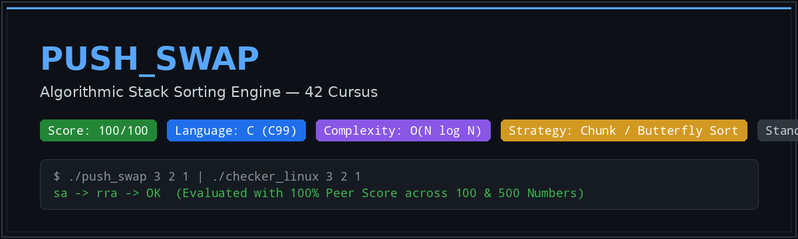
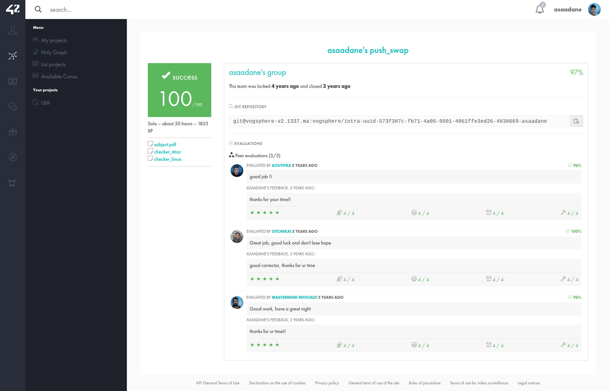
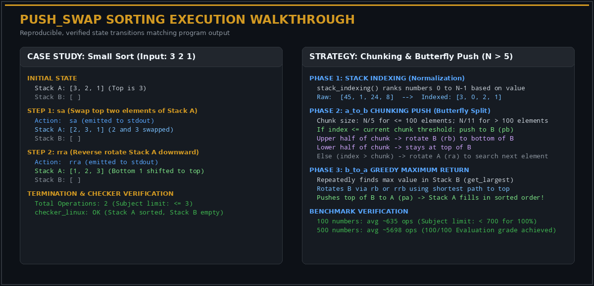

*This project has been created as part of the 42 curriculum by asaadane.*

# Push_swap — Algorithmic Stack Sorting Engine



## Overview

**Push_swap** is an algorithmic programming project from the 42 School curriculum. The objective is to sort a set of unique signed integers using two stacks (`Stack A` and `Stack B`) and a strictly limited instruction set, producing the smallest possible sequence of operations.

This implementation achieved an official evaluation score of **100/100**, sorting:
- **100 numbers** in an average of **~635 operations** (42 benchmark: $< 700$ operations).
- **500 numbers** in an average of **~5698 operations** (42 benchmark: $< 8500$ operations).
- **3 numbers** in at most **2 operations** (42 benchmark: $\le 3$ operations).

---

## 42 Official Evaluation Score



> Validated with **100/100** by 3 peer evaluators on 42 Intra.

---

## How Push_swap Works

You are given two stacks named **A** and **B**:
- **Stack A**: Initially contains a random list of positive and negative unique integers.
- **Stack B**: Initially empty.
- **Goal**: Sort the numbers in Stack A in ascending order such that the smallest number is at the top and the largest is at the bottom.

### Available Operations (11 Primitive Instructions)

| Family | Operation | Action |
|---|---|---|
| **Swap** | `sa` / `sb` / `ss` | Swap the first 2 elements at the top of stack A, stack B, or both. |
| **Push** | `pa` / `pb` | Take the top element of one stack and push it to the top of the other. |
| **Rotate** | `ra` / `rb` / `rr` | Shift all elements of a stack up by 1 (the first element becomes the last). |
| **Reverse Rotate** | `rra` / `rrb` / `rrr` | Shift all elements of a stack down by 1 (the last element becomes the first). |

For detailed operation mechanics and array shift behavior, see [docs/STACK_OPERATIONS.md](docs/STACK_OPERATIONS.md).

---

## Sorting Strategy

Rather than relying on naive $O(N^2)$ sorts or generic sorting networks, this repository employs a specialized dual-pipeline strategy:

```
[Input Size]
     │
     ├── N <= 5  ──> Hardcoded Optimal Pattern Matching (Small Sort)
     │                • Size 2: Single conditional swap (sa)
     │                • Size 3: Permutation pattern tree (at most 2 ops)
     │                • Size 4-5: Minimum extraction to B + sub-sort
     │
     └── N > 5   ──> Coordinate Compression + Windowed Chunking (Butterfly Sort)
                      1. Rank Indexing: Replaces values with ranks in [0, N-1]
                      2. Chunk Partitioning (a_to_b): Pushes windowed chunks to B
                         • Upper chunk half rotated to bottom of B (rb)
                         • Lower chunk half kept at top of B
                      3. Maximum Extraction (b_to_a): Shortest-path greedy return to A
```



For complete mathematical breakdown and complexity proofs, see [docs/ALGORITHMS.md](docs/ALGORITHMS.md).

---

## Architecture & Memory Model

- **Data Representation**: Dynamically allocated contiguous 0-indexed `int` arrays (`int *a`, `int *b`) managed via `t_stack` and `t_size` structs.
- **Zero Heap Waste**: Memory is pre-calculated via `count_argv()` and allocated in a single pass.
- **Robust Error Handling**: Explicit syntax validation, sign validation, duplicate detection, and standard error emission to `stderr`.

```text
CLI Arguments -> Tokenizer -> Lexical Check -> Array Loader -> Validator -> Strategy Router -> stdout
```

Detailed architectural diagrams and call graphs are available in [docs/ARCHITECTURE.md](docs/ARCHITECTURE.md).

---

## Quickstart & Build Instructions

### Compilation

Build the executable using GNU `make`:

```bash
make
```

To remove object files or perform a clean rebuild:

```bash
make clean    # Remove object files
make fclean   # Remove object files and executable
make re       # Clean and rebuild
```

### Execution

```bash
# Separate arguments
./push_swap 3 2 1

# Quoted argument
./push_swap "3 2 1"

# Large randomized input
./push_swap 15 3 22 8 1 9 45 12
```

### Verification with the 42 Checker

```bash
# Basic check
./push_swap 3 2 1 | ./checker_linux 3 2 1
# Output: OK

# Count total operations on 100 random numbers
ARG=$(shuf -i 0-10000 -n 100 | tr '\n' ' ')
./push_swap $ARG | ./checker_linux $ARG
./push_swap $ARG | wc -l
```

For complete compilation guidelines, platform notes, and environment troubleshooting, see [docs/BUILD_AND_USAGE.md](docs/BUILD_AND_USAGE.md).

---

## Repository Structure

```text
Push_swap_42-cursus/
├── Makefile                # Strict build system (-Wall -Wextra -Werror)
├── README.md               # Quickstart and project overview
├── push_swap.h             # Type definitions and function prototypes
│
├── push_swap.c             # Program entry point, sorting coordinator, cleanup
├── parsing.c               # Argument parsing, word splitting, token allocation

├── operations_a.c          # Stack A operations (sa, ra, rra, pa)
├── operations_b.c          # Stack B operations (sb, rb, rrb, pb)
├── operations_both.c       # Synchronized dual operations (ss, rr, rrr)
│
├── small_sort.c            # Small input algorithms (size 2 to 5)
├── large_sort.c            # Chunking, indexing, and greedy return algorithms
│
├── stack_init.c            # Stack allocation & memory deallocation
├── validation.c            # Input & state verification (duplicates, sorted, signs)
├── sort_utils.c            # Stack query helpers (get_smallest, get_largest, position)
├── convert_utils.c         # Integer conversion (atoi), character checks, error exit
├── string_utils.c          # Core string & memory utilities (strlen, memcpy, strdup, strncpy, strncmp)
└── split_utils.c           # Auxiliary string & array split utilities
│
├── checker_linux           # Official 42 Linux x86_64 checker binary
├── checker_Mac             # Official 42 macOS x86_64 checker binary
├── en.subject.pdf          # Official 42 project subject specification
├── pushswap-100.png        # Official 42 evaluation certificate (100/100)
│
├── assets/                 # Architecture, operations, and benchmark visual assets
└── docs/                   # Exhaustive technical documentation suite
    ├── PROJECT_AUDIT.md    # Comprehensive code audit and implementation defect notes
    ├── ARCHITECTURE.md     # Pipeline design, data structures, and Mermaid diagrams
    ├── ALGORITHMS.md       # Chunking mathematics, small sort trees, and complexity
    ├── STACK_OPERATIONS.md # Detailed specification of all 11 operations
    ├── PARSING_AND_VALIDATION.md # Grammar, boundary cases, and error protocol
    ├── BUILD_AND_USAGE.md  # Build targets, platform compatibility, and troubleshooting
    └── TESTING.md          # Test matrices, verified test cases, and reproducible scripts
```

---

## Technical Skills & Concepts Demonstrated

- **Algorithmic Complexity & Optimization**: Designing an $O(N \log N)$ windowed chunking algorithm meeting strict operational limits.
- **Low-Level Memory Management in C**: Managing contiguous dynamic arrays without memory leaks or buffer overflows.
- **Defensive Input Parsing**: Robust tokenization supporting both quoted strings and separate arguments with rigorous integer overflow validation.
- **POSIX System Programming**: Interacting directly with Unix file descriptors (`stdout` and `stderr`) and standard exit codes.
- **Verification & Testing**: Automated benchmarking and pipeline integration with external test harnesses (`checker_linux`).

---

## Author & Attribution

- **Author**: [asaadane](https://github.com/asaadane) (42 Network)
- **Evaluation Grade**: 100/100 (Validated on 42 Intra)
- **Subject**: 42 Cursus Push_swap Version 10.2
