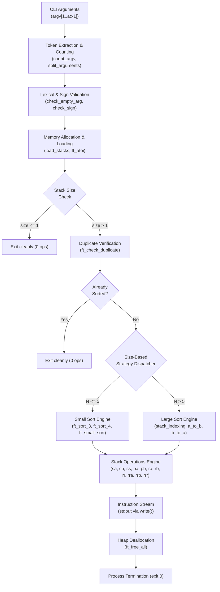

# System Architecture & Design Specification

## 1. Overview

Push_swap is structured as a modular pipeline that ingests raw command-line arguments, validates lexical and numerical formatting, loads and normalizes two array-backed stacks, routes to an appropriate sorting strategy, and writes an optimized stream of stack operations to standard output.

---

## 2. High-Level Architecture Diagram



---

## 3. Data Structures & Stack Representation

### Contiguous Dynamic Array Design

Rather than using linked lists (`t_list` or doubly circular linked nodes), this implementation utilizes **flat, dynamically allocated contiguous integer arrays**.

```c
typedef struct s_stack
{
    int *a;   /* Contiguous array buffer for Stack A */
    int *b;   /* Contiguous array buffer for Stack B */
} t_stack;

typedef struct s_size
{
    int a;    /* Current count of active elements in Stack A */
    int b;    /* Current count of active elements in Stack B */
} t_size;

typedef struct s_spl
{
    int   spl_idx; /* Current index in splited token array */
    int   w_srt;   /* Starting offset of current word */
    int   w_len;   /* Length of current word */
    char *arg;     /* Pointer to the current argument string */
} t_spl;
```

### Architectural Trade-Offs

| Metric | Contiguous Array (This Repo) | Doubly Linked List |
|---|---|---|
| **Memory Footprint** | Low ($4 \times N$ bytes per stack, contiguous) | Higher ($24 \times N$ bytes per stack on 64-bit: int + 2 pointers) |
| **Cache Locality** | Optimal (sequential reads, high L1/L2 cache hit rate) | Poor (pointer chasing across heap memory) |
| **Top-of-Stack Access** | $O(1)$ constant time (`stack->a[0]`) | $O(1)$ constant time (`head->value`) |
| **Push / Pop Overhead** | $O(N)$ linear memory shifts | $O(1)$ pointer reassignment |
| **Rotate Overhead** | $O(N)$ linear memory shifts | $O(1)$ pointer reassignment |

Because the maximum input for Push_swap is 500 integers, the $O(N)$ memory shift operations take negligible wall-clock time (< 1 ms on modern hardware) while providing deterministic memory layout and zero pointer allocation overhead per node.

---

## 4. Execution Pipeline & Layer Breakdown

### Layer 1: Ingestion & Tokenization
- Handles both multi-argument inputs (`./push_swap 3 2 1`) and quoted string lists (`./push_swap "3 2 1"`).
- `count_argv`: Traverses `av[1..]` and computes the exact total token count needed for heap pre-allocation.
- `split_arguments`: Allocates a string pointer array of size `size->a + 1` and extracts whitespace-delimited tokens using `spl_arg` and `splited_elements`.

### Layer 2: Validation & Stack Population
- `check_empty_arg`: Guarantees non-empty token sequences.
- `load_stacks`: Allocates `stack->a` and `stack->b` to hold `size->a + 1` integers each.
- `check_sign`: Enforces that token length does not exceed 12 characters, verifies valid signs (`+` or `-`), and confirms all remaining characters are digits (`ft_isdigit`).
- `ft_atoi`: Converts each validated token into a signed integer.
- `ft_check_duplicate`: Compares all pairs in Stack A in $O(N^2)$ time to reject duplicate values.
- `ft_check_sorted`: Checks if `stack->a[i] > stack->a[i+1]`. If strictly sorted, the program exits immediately without emitting any instructions.

### Layer 3: Algorithm Dispatcher (`sorting()`)
Selects the sorting path based on input size:
1. **$N \le 5$ Elements**: Routed to `ft_small_sort(stack, size)` in `small_sort.c`.
2. **$5 < N \le 100$ Elements**: Routed to `large_sort(stack, size, 5)` in `large_sort.c` using 5 chunks.
3. **$N > 100$ Elements**: Routed to `large_sort(stack, size, 11)` in `large_sort.c` using 11 chunks.

### Layer 4: Operations Engine
- All 11 operations output their canonical instruction name followed by a newline directly to file descriptor 1 (`write(1, "op\n", len)`).
- Subroutines (e.g. `ss`, `rr`, `rrr`) invoke individual stack routines with a print suppress flag `p = 0` to prevent duplicate console logging.

### Layer 5: Teardown & Memory Reclamation
- Upon completion of sorting or detection of pre-sorted input, `ft_free_all` releases `stack->a`, `stack->b`, the `t_stack` structure, all string tokens in `splited`, and the `t_size` structure.

---

## 5. Source Code File Map

```text
push_swap/
├── Core & Orchestration
│   ├── push_swap.c           # main(), sorting()
│   ├── stack_init.c          # load_stacks(), free_arguments(), ft_free_all()
│   └── push_swap.h           # Data models and cross-module prototypes
├── Parsing & Validation
│   ├── parsing.c             # count_argv(), count_words(), split_arguments()
│   └── validation.c          # check_sign(), check_empty_arg(), ft_check_duplicate(), ft_check_sorted()
├── Stack Operations
│   ├── operations_a.c        # pa, sa, ra, rra
│   ├── operations_b.c        # pb, sb, rb, rrb
│   └── operations_both.c     # ss, rr, rrr
├── Sorting Engines
│   ├── small_sort.c          # ft_sort_3, ft_sort_4, ft_small_sort
│   ├── large_sort.c          # stack_indexing, a_to_b, b_to_a, large_sort
│   └── sort_utils.c          # get_largest, get_smallest, get_number_position, small_to_top
└── Utilities & Conversion
    ├── convert_utils.c       # ft_atoi(), ft_isdigit(), ft_put_error()
    ├── string_utils.c        # ft_strlen, ft_memcpy, ft_strdup, ft_strncpy, ft_strncmp
    └── split_utils.c         # ft_split, ft_substr, ft_strjoin, ft_count, ft_count_stack
```
