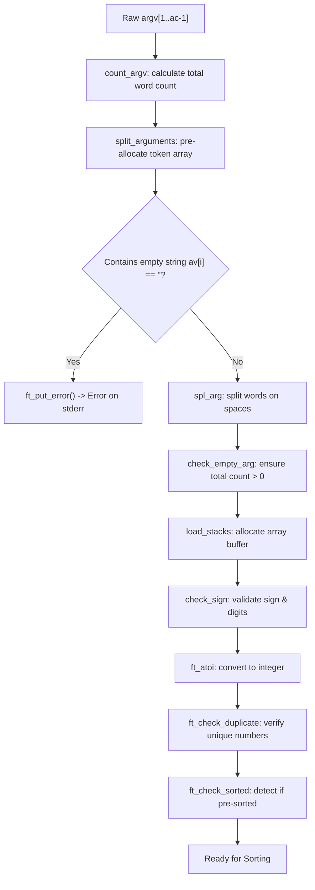

# Input Parsing, Validation & Error Handling

## 1. Input Specification & Supported Formats

Push_swap accepts integer lists in three distinct command-line formats:

### 1. Separate Arguments
Each integer is passed as an individual CLI parameter:
```bash
./push_swap 42 -13 0 99 7
```

### 2. Quoted String
Multiple integers are encapsulated within a single string delimited by spaces:
```bash
./push_swap "42 -13 0 99 7"
```

### 3. Mixed Arguments
Combinations of individual parameters and quoted strings:
```bash
./push_swap "42 -13" 0 "99 7"
```

---

## 2. Parsing Pipeline



### Word Counting & Token Extraction
1. `count_argv`: Iterates through `av[1..]` and uses `count_words` to determine the exact number of integers passed across all arguments.
2. `split_arguments`:
   - Rejects empty strings (`""`) immediately via `ft_strncmp(av[i], "", 1) == 0`.
   - Allocates `splited` pointer array with `malloc(sizeof(char *) * (*size_a + 1))`.
   - Invokes `spl_arg` which traverses each character, tracks word starts and lengths (`t_spl`), and allocates substrings using `splited_elements`.

---

## 3. Validation Rules & Constraint Checks

### 1. Lexical Verification (`check_sign`)
Before converting each token string to a number, `check_sign(splited[i])` verifies:
- **String Length**: Rejects strings longer than 12 characters (`ft_strlen > 12`) to filter out excessive leading zeros or large overflow strings.
- **Sign Syntax**: Permits a single optional leading sign (`+` or `-`). If a sign is present, it must be immediately followed by numeric digits; a lone sign (`"+"` or `"-"`) triggers an error.
- **Digit Check**: Verifies that every subsequent character is a valid ASCII digit (`'0'` through `'9'`) via `ft_isdigit()`.

### 2. Range Validation & Integer Boundaries (`ft_atoi`)
Converted numbers must reside strictly within standard 32-bit signed integer limits:
$$-2,147,483,648 \le x \le 2,147,483,647 \quad (\text{INT\_MIN} \le x \le \text{INT\_MAX})$$

```c
int ft_atoi(char *str)
{
    long int result;

    result = ft_atoi_tool(str);
    if (INT_MIN <= result && result <= INT_MAX)
        return (result);
    else
        ft_put_error();
    return (0);
}
```

*Note on Implementation Discovery*: In the current code, `ft_atoi_tool` uses an `int` accumulator, which can wrap before being cast to `long int` inside `ft_atoi`. See [PROJECT_AUDIT.md](PROJECT_AUDIT.md#defect-3-32-bit-integer-overflow-in-ft_atoi_tool) for details.

### 3. Duplicate Detection (`ft_check_duplicate`)
Push_swap requires that all input integers be unique:
```c
void ft_check_duplicate(int *stack_a, int size_a)
{
    int i = 0, j;

    while (i < size_a - 1)
    {
        j = i + 1;
        while (j < size_a)
        {
            if (stack_a[i] == stack_a[j])
                ft_put_error();
            j++;
        }
        i++;
    }
}
```
If two identical numbers are detected, the program prints `Error\n` and exits with code 1.

### 4. Sorted Detection (`ft_check_sorted`)
```c
bool ft_check_sorted(int *stack_a, int size_a)
{
    int i = 0;

    while (i < size_a - 1)
    {
        if (stack_a[i] > stack_a[i + 1])
            return (false);
        i++;
    }
    return (true);
}
```
If the array is already sorted ascending, the program performs full memory cleanup via `ft_free_all()` and exits with code 1 without writing any instructions to `stdout`.

---

## 4. Error Protocol & Exit Codes

In accordance with the 42 subject specification:
- **Error Channel**: When an error occurs, the string `"Error\n"` is written strictly to file descriptor 2 (standard error):
  ```c
  void ft_put_error(void)
  {
      write(2, "Error\n", 7);
      exit(1);
  }
  ```
- **Error Exit Code**: Status code `1`.
- **Zero Arguments**: When executed with no parameters (`ac < 2`), the program exits quietly with status code `1` and emits no error message.
- **Single Element**: When passed a single element (`size->a <= 1`), the program exits quietly with status code `1` and emits no instructions.
